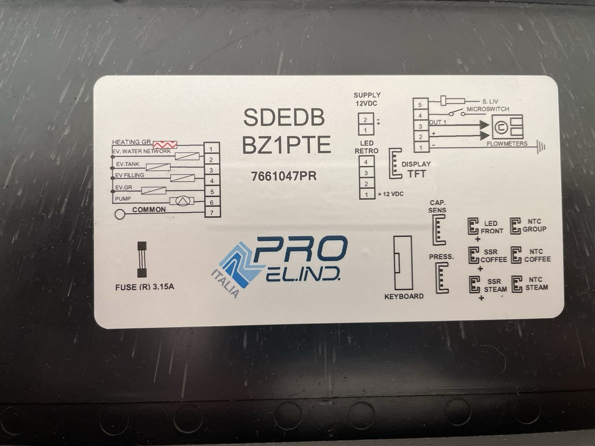
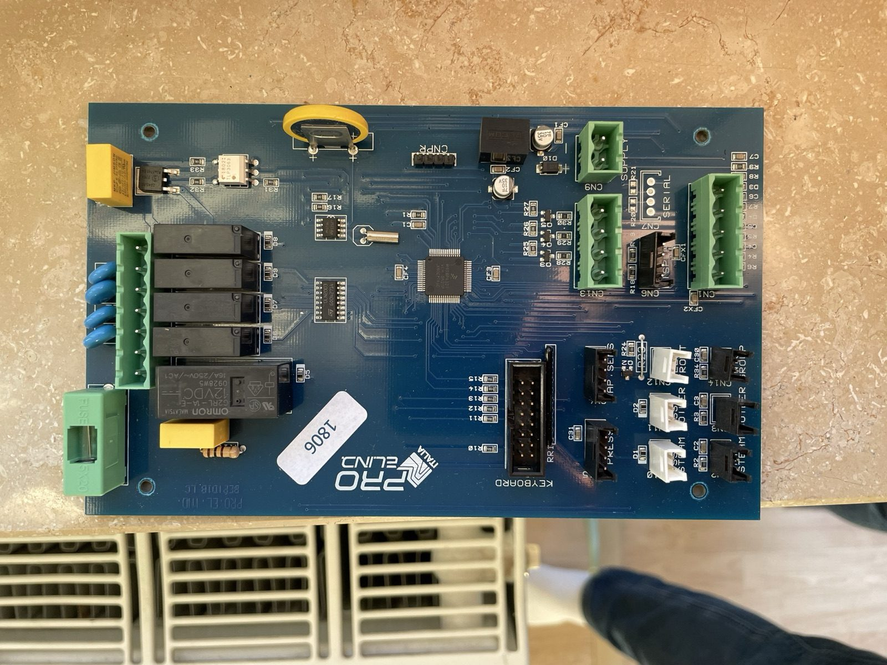
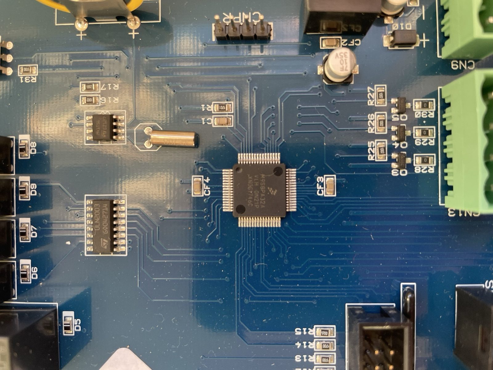
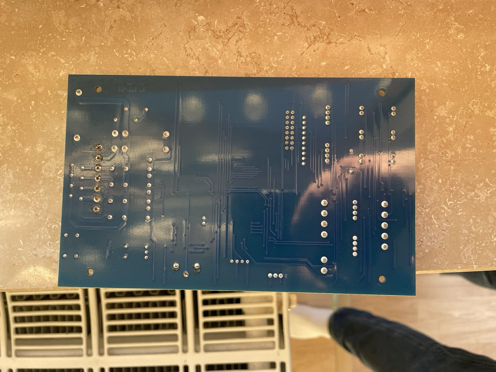

<b>Deutsch</b>

# Mainboard: Plattform, verwandte Maschinen, Firmware

Stand der Recherche vom 06.10.2026. Was hier steht, ist belegt (Quelle oder
Messung) oder als Vermutung gekennzeichnet.

## Pro.El.Ind als Plattform

Das Mainboard der Duo DE stammt von **PRO.EL.IND** (Italien), MCU NXP
**MC9S08PA32** im LQFP-64 ([README](../README.md#das-mainboard)). Pro.El.Ind
entwickelt Hardware und Firmware im Auftrag verschiedener
Kaffeemaschinenhersteller, aus einem Katalog angepasst oder ganz nach Wunsch.

**Arbeitshypothese:** gemeinsame Hardware- und Firmware-Basis (MCU, Treiber,
Anbindung des DWIN-Displays), je Hersteller eigene Konfiguration und Oberfläche.
Gleiche Bauteilfamilien und gleiches Display-Protokoll sind wahrscheinlich,
gleiche komplette Firmware, Pinbelegung oder VP-Adressen nicht. Das muss jede
weitere Maschine einzeln zeigen.

## Rocket R58 (Cinquantotto): dieselbe Protokollfamilie

Im [Kaffee-Netz-Thread „Rocket R58 Cinquantotto USB-Protokoll“](https://www.kaffee-netz.de/threads/rocket-r58-cinquantotto-usb-protokoll.139064/)
(2021–2024, Hauptanalyse von *HanDeKe*) steht für die R58:

- Elektronik von Pro.El.Ind, MCU **MC9S08PA32**, UART an den Pins 23/24
- Display als „Remote-Display“, Maschine ist Master und fragt ab
- 115200 Baud, 8N1; ältere Displays mit 6-poligem Stecker, neuere mit USB-B,
  dahinter trotzdem serielle Daten
- Rahmenkopf `90 165` = **`5A A5`**, „Nachrichtentyp 131“ = **`0x83`**

Gegen das Modell dieses Repos gerechnet:

| R58-Rahmen (dezimal) | als DWIN gelesen |
|---|---|
| `90 165 6 131 16 0 3 104 100` | `5A A5 06` · `83 1000 03` (3 Worte ab VP `0x1000` lesen) · `68 64` |
| `90 165 12 131 16 0 3 0 x 0 y 0 0 216 224` | Antwort des Displays: `83 1000 03` + 3 Worte + 2 Byte |

**Die letzten zwei Byte sind eine CRC16 (Modbus) über `83 10 00 03`:
berechnet `0x6468`, im Rahmen `68 64`** (geprüft 06.10.2026). Die R58 nutzt also
denselben DWIN-DGUS-Befehlssatz wie die Duo, mit Standardkopf `5A A5` und
**eingeschalteter CRC** (DWIN-Register R2, Bit 4). Die Duo hat Kopf `C6 A5` und
keine CRC. Die Vermutung im Thread („CRC16“) stimmt; „Nachrichtentyp 131“ ist der
DGUS-Befehl „VP lesen“, und das Display meldet Werte nur, wenn die Maschine fragt.

Die lange R58-Nachricht (35 Byte) ließ sich aus der abgerufenen Fassung nicht
nachrechnen (CRC passt nicht); dafür braucht es die Bytes aus dem Originalbeitrag.

## Ersatz-Mainboard: Befund aus Fotos (08.10.2026)

Zweites Board SDEDB / BZ1PTE / 7661047PR, Aufkleber `1806` (Juni 2018),
Leiterplatte „PRO.EL.IND. BEP1D1B LC“.

| | |
|---|---|
|  |  |
|  |  |

| Bauteil | Befund | Bedeutung |
|---|---|---|
| MCU | **M9S08PA32A VLH**, Datumscode 1746 (Nov. 2017) | VLH = LQFP-64, passt zum Handbuch (BKGD Pin 64, RESET Pin 63) |
| CNPR | 4 Stifte links unter der MCU, bestückt; daneben R1/C1 (typisch RESET-Pull-up + Kondensator) | BDM-Kandidat; BKGD (Pin 64) und RESET (Pin 63) liegen an der Ecke zur CNPR hin; Belegung stromlos durchmessen |
| CN7 „SERIAL“ | 4 Lötaugen, **unbestückt**, neben CN6 (Display); R20/R21 darüber ebenfalls unbestückt (vermutlich Serienwiderstände TX/RX), CN7 also derzeit von der MCU getrennt | vermutlich zweite serielle Schnittstelle (Service/Werkstatt); Pegel und Belegung messen |
| Quarz | Zylinder (Uhrenquarz 32,768 kHz) neben dem 8-Pin-Uhrenbaustein M41T56 | gehört zur Echtzeituhr; die MCU läuft vermutlich mit internem Takt (ICS), EXTAL/XTAL prüfen |
| Relais | 4 kleine Relais + Omron G2RL 16 A (Heizung Gruppe), ULN2003 als Treiber | Ein/Aus-Ausgänge 1–5 |
| TLP3063 + Triac (DPAK) + X2-Kondensator | Nullspannungs-Optokoppler | Pumpe: nur ganze Netzwellen ein/aus. Phasenanschnitt (Druckregelung) geht damit nicht, höchstens Wellenpaket-Takten |
| Q3–Q5 mit R28–R30 | Transistoren an CN13 „LED RETRO“ | LED-Ausgänge 12 V |
| Steckverbinder | CN1 Füllstand/Mikroschalter/Durchflussmesser, CN6 Display, CN9 12 V, CN13 LED, Keyboard 2×8, NTC Gruppe/Kaffee/Dampf, SSR Kaffee/Dampf, PRESS., CAP. SENS | wie Deckelaufkleber |

## Vergleichsmatrix (Stand 08.10.2026)

| Maschine | Elektronik | MCU | Display | Kopf / CRC | Quelle |
|---|---|---|---|---|---|
| Bezzera Duo DE (2018) | Pro.El.Ind, SDEDB / BZ1PTE | MC9S08PA32, LQFP-64 | DWIN Mini DGUS 320×240 | `C6 A5`, ohne CRC | gemessen (dieses Repo) |
| Rocket R58 Cinquantotto | Pro.El.Ind | MC9S08PA32 | Remote-Display (6-polig, später USB-B) | `5A A5`, CRC16 | Kaffee-Netz-Thread, CRC nachgerechnet |
| Rocket Giotto/Cellini Plus V2, Appartamento | Pro.El.Ind LIV-RET3A/B (Füllstandsregler) | ? | keins | – | [Ersatzteil](https://espressocare.com/products/rocket-giotto-control-box) |
| ältere Bezzera (Füllstand) | Pro.El.Ind LIV-BZ3SC | ? | keins | – | [Ersatzteil](https://www.ebay.com/itm/175267981152) |
| Fiorenzato (Gastro) | Pro.El.Ind „Brain Unit“ SDE3D F13 | ? | Tastenfeld | ? | [1st-line](https://www.1st-line.com/buy/pro-el-ind-a1500095/) |

Mit DWIN-Display und Mitschnitt bekannt sind bisher nur Duo und R58. Weitere
Maschinen hier ergänzen, sobald Mitschnitte oder Fotos der Platine vorliegen;
`tools/duo_sniff.py dgus` liest beide Varianten (Kopf und CRC automatisch).

## Firmware sichern über BDM (abgebrochen am 25.10.2026)

Der S08 hat eine Ein-Draht-Debugschnittstelle (BDM). Laut NXP-Referenzhandbuch
MC9S08PA60/PA32 (Rev. 3, Tabelle 2-1), LQFP-64:

| Signal | Pin (64) | Pin (48) | Pin (44) |
|---|---|---|---|
| PTA4/BKGD/MS | 64 | 48 | 44 |
| PTA5/RESET | 63 | 47 | 43 |
| VDD | 7, 41 | 5, 31 | 5, 28 |
| VSS | 10, 13, 40 | 8, 11, 30 | 8, 11, 27 |
| EXTAL/XTAL | 11/12 | 9/10 | 9/10 |

**CNPR** (4 Pole, unbestückt) passt zu GND, VDD, BKGD, RESET. Bestätigen per
Durchgangsprüfung, stromlos.

**Wichtig zur Sicherung (Security):** Ist die Flash-Sicherung gesetzt
(`NV_FSEC[SEC]`), liest BDM den Flash nicht aus. Der Backdoor-Schlüssel lässt
sich laut Handbuch **nicht** über BDM eingeben, nur aus laufendem Code. Bleibt
dann nur das **Komplettlöschen**, und danach ist das Mainboard leer. Deshalb:

- nur am **alten Ersatz-Mainboard** versuchen, nie an der Maschine im Betrieb
- nur lesen; jede Abfrage eines Programmers „Gerät gesichert, löschen?“ ablehnen
- zuerst den Sicherungszustand abfragen, dann erst Speicher lesen

Gelingt der Dump: 32 KB Flash + 256 B EEPROM in Ghidra (HCS08), Ziel ist die
Zuordnung MCU-Pin → Stecker → Funktion und die Zustandsmaschine der Maschine.
### Erster USBDM-Versuch (13.10.2026)

- USBDM (JMxx, Firmware 4.12, VID 16D0 PID 0567) läuft am Mac ohne Herstellersoftware
  über `tools/usbdm_lesen.py` (nur lesend; `--special` für Reset in den Debug-Modus,
  `--watch N` zum Mitlaufen beim Umstecken).
- **Keine Verbindung** (SYNC_TIMEOUT). Die Spannungsanzeige des USBDM („extern“) und
  RESET „high“ erscheinen auch **ohne** angeschlossenes Board, sie taugen nicht als Prüfung.
- Ein MacBook liefert an USB-C nur 5 V; ein 12-V-PD-Trigger bleibt daran stromlos.
  Board an einem Netzteil mit 12 V (PD-Ladegerät ab etwa 30 W oder 12-V-Netzteil) betreiben.
- Stecker am USBDM: rote Ader = Spalte mit Pin 1 (BKGD) und 2 (GND); GND, RESET (4) und
  VDD (6) liegen in einer Reihe. Welche Reihe Pin 1 ist, per Durchgang USB-Gehäuse ↔ Loch klären.
- Nächster Schritt: die vier CNPR-Spannungen gegen Minus an CN9 messen (USBDM abgezogen),
  dann gezielt verdrahten.

### CNPR mit dem Logic Analyzer (25.10.2026)

Board am 12-V-Netzteil, Logic Analyzer (fx2lafw, Windows, sigrok-cli) an den vier
CNPR-Stiften. Ader → Kanal:

| Ader | Analyzer | Pegel im Betrieb | Deutung |
|---|---|---|---|
| blau | CH1 / D0 | 1 | VDD, RESET oder BKGD |
| grün | CH2 / D1 | 1 | VDD, RESET oder BKGD |
| gelb | CH3 / D2 | 0 | **vermutlich GND** |
| orange | CH4 / D3 | 1 | VDD, RESET oder BKGD |

- Aus- und Einschalten (`zyklus.sr`, 45 s, 2 MHz): Stromlos lesen alle vier Kanäle 1,
  auch gelb. Die Masse des Analyzers lag also nicht am Board; die Verbindung lief nur über
  Netzteil und PC (50-Hz-Brummen auf allen vier Kanälen beim Einstecken).
- Zweite Aufnahme (`zyklus2.sr`, 35 s, 4 MHz) mit Analyzer-Masse an Minus von CN9:

  | Ader | Ausschalten fällt | Einschalten steigt | Signal |
  |---|---|---|---|
  | orange (D3) | zuletzt (+46 ms) | zuerst (0 ms) | **VDD** (Siebkondensator hält am längsten) |
  | blau (D0) | +20 ms | +2,5 ms, langsame verrauschte Flanke | **RESET** (RC über R1/C1) |
  | grün (D1) | zuerst (0 ms) | zuletzt (+10,6 ms), saubere Flanke | **BKGD** (Pull-up nach dem Reset) |
  | gelb | – | – | **GND** (3. Stift von links, Stift „P“) |

  Die erste Deutung (blau = BKGD) wurde verworfen; die scheinbare Sync-Antwort mit BKGD an grün
  erwies sich später als Artefakt (siehe unten). Grün = BKGD ist also nur aus dem Zeitverhalten
  geschlossen, nicht per BDM bestätigt.

**Belegung CNPR (25.10.2026):** gelb = GND (Durchgang zu Minus CN9), orange = VDD (5 V gemessen),
grün = BKGD und blau = RESET (vermutet, aus dem Zeitverhalten).

USBDM-Stecker (6-polig, Freescale-BDM-Standard, Draufsicht):

| | |
|---|---|
| 1 BKGD | 2 GND |
| 3 frei | 4 RESET |
| 5 frei | 6 VDD (Messeingang; USBDM speist nicht, `SET_VDD OFF`) |

**Falle beim vorhandenen USBDM (JS16, FW 4.12):** Das Flachband sitzt gespiegelt, die
**rote Ader ist GND**, nicht Pin 1. Gemessen (Selbsttest ohne Board, Analyzer an allen Adern):

| Flachband-Ader | Signal | an CNPR |
|---|---|---|
| 1 (rot) | GND (Durchgang zum USB-Gehäuse) | gelb |
| 2 | BKGD (Sync-Pulse ~1 ms) | grün |
| 3 | RESET (laut Spiegelung; dieser USBDM treibt RESET nicht) | blau |
| 4 | frei | – |
| 5 | VDD-Messeingang (laut Spiegelung) | orange |
| 6 | frei | – |

Weitere Fallen dieses Tages:

- Logic Analyzer ohne USB, aber mit Adern am Board, speist sich über die Eingänge aus VDD und
  zieht die MCU in den Reset. Erst USB einstecken, dann die Adern anklemmen.
- Ohne gemeinsame Masse (12-V-Netzteil potentialfrei) liest der USBDM RESET falsch als LOW.
- Der USBDM treibt RESET nicht; `--special` bringt also nichts. Debug-Einstieg von Hand:
  BKGD (grün) beim Einstecken der 12 V gegen GND halten.

Stand der Verbindung: Die scheinbare Sync-Antwort (~1,32 MHz, danach `BDM_EN_FAILED`) kam
genauso **ohne** Board-Spannung, war also ein Artefakt. Ursache: Der USBDM-Klon („USB BDM
Freescale“, JS16) hat einen Jumper „Target Vdd supply“ (TVDD–TVDD / TVDD–5V / TVDD–3V3). In
der Stellung TVDD–TVDD sind seine Treiber unversorgt; BKGD (Ader 2) und VDD (Ader 5) ziehen
die 5 V des Boards dann auf 1,7–1,9 V herunter, die MCU hängt im Reset. `getcap` meldet weder
VDD-Steuerung noch VDD-Messung, „Vdd-External“ und die PWR-LED sagen nichts.
Mit Jumper auf TVDD–5V (Adapter allein gemessen): Ader 5 = 5 V Ausgang, Ader 2 = 3,6 V,
Ader 3 = 3,5 V (Pull-ups) – bestätigt die gespiegelte Belegung.

**Schaden am Ersatzboard (25.10.2026):** Mit Jumper TVDD–5V und allen vier Adern an CNPR
(1→P/gelb, 2→N/grün, 3→C/blau, **5→R/orange**) bei ausgeschalteten 12 V lief das Board aus dem
USB-5-V des Adapters an (Relais schaltete); beim Zuschalten der 12 V rauchte die MCU. Danach VDD–GND 1,9 Ω, Kurzschluss in der MCU selbst; die Firmware dieses Boards ist verloren. Vermutete
Ursachen (nicht belegt): zwei 5-V-Quellen parallel auf VDD und/oder Latch-up durch Signale an
der MCU vor ihrer eigenen Versorgung. Regeln für jeden weiteren Versuch:

- Bei Jumper TVDD–5V/3V3 ist Ader 5 ein **Ausgang**: nie an ein selbst versorgtes Board.
- Erst Board einschalten, dann BDM-Signale anschließen; beim Abschalten umgekehrt.
- Erstversuche an einem neuen Board mit strombegrenztem Labornetzteil.

Stiftfolge CNPR von links: C = blau (RESET, vermutet), N = grün (BKGD, vermutet),
P = gelb (GND, Durchgang zu Minus CN9), R = orange (VDD, 5 V gemessen).

Offen in [Issue „Firmware über BDM sichern“](https://github.com/larszu/bezzera-duo-protocol/issues).

## Korrekturen zu einer KI-Recherche (ChatGPT, Oktober 2026)

- „R58 ohne CRC“: falsch, die R58 nutzt CRC16 (siehe oben).
- „MC9S08PA32 im 48-Pin-Gehäuse“: bei der Duo LQFP-64 (Foto, README).
- „Backdoor-Schlüssel über BDM entsperren“: laut Handbuch nicht möglich.
- Druck- oder Flussregelung wie Gaggiuino: die Duo schaltet die Pumpe nur ein und
  aus (Relais); Regelung bräuchte Hardware (Dimmer/Pumpensteuerung).
